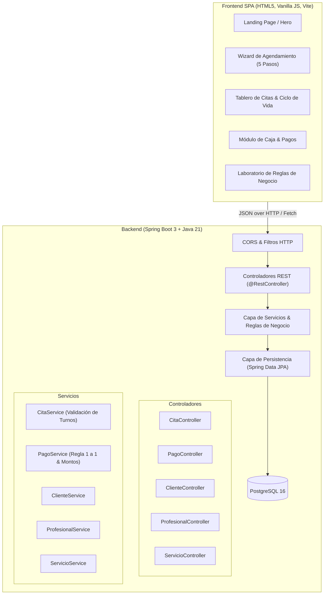
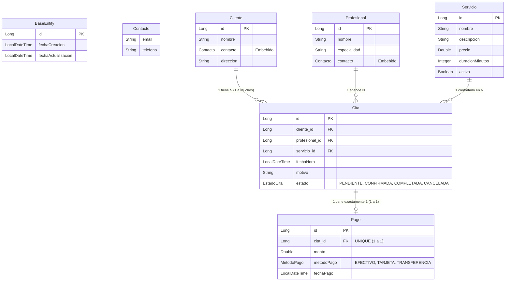
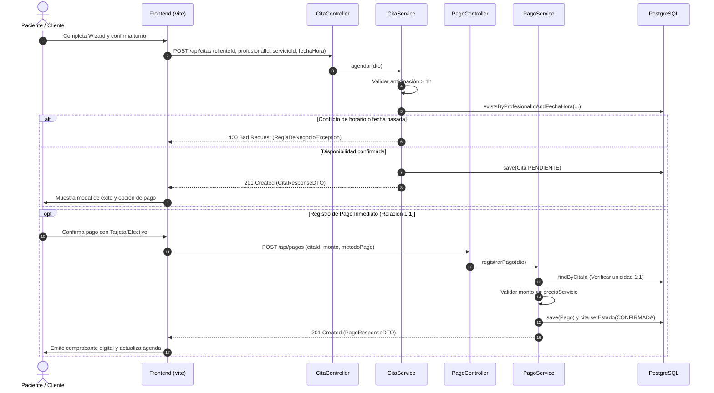

<div align="center">

# 🩺 SerenityCare | Healthcare & Appointment Booking Platform
### Sistema Integral de Agendamiento Médico, Facturación 1 a 1 y Gestión de Pacientes

[](https://spring.io/projects/spring-boot)
[](https://www.oracle.com/java/)
[](https://www.postgresql.org/)
[](https://www.docker.com/)
[](https://render.com)
[](https://vitejs.dev/)
[](LICENSE)

<br/>

**SerenityCare** es una solución de nivel empresarial para clínicas, centros de salud y consultorios profesionales. Combina una **API REST desacoplada construida en Java con Spring Boot 3 y persistencia PostgreSQL**, con una **Single Page Application (SPA) moderna, responsiva y de alto rendimiento** que ofrece agendamiento asistido por pasos, gestión de citas en tiempo real, pasarela de cobro 1 a 1 y un laboratorio educativo de validación de reglas de negocio.

[Explorar Documentación Técnica](#-documentación-y-tutorial-paso-a-paso) • [Ver Endpoints](#-catálogo-de-endpoints-api-rest) • [Instalación Rápida](#-puesta-en-marcha-local) • [Despliegue Cloud](#-despliegue-con-docker-y-render)

</div>

---

## 🌟 Aspectos Destacados del Proyecto

- **Arquitectura Limpia y Desacoplada:** Separación estricta entre capa Web (`Controller`), Lógica (`Service`), Persistencia (`Repository`) y Transferencia de Datos (`DTO`).
- **Java Estándar Explícito (Zero Lombok):** Código 100% transparente sin dependencias invasivas ni advertencias de reflexión en el JDK.
- **Patrón DTO con Java Records:** Uso de estructuras inmutables para `RequestDTO` y `ResponseDTO`, previniendo sobre-exposición de entidades y dependencias cíclicas en JSON.
- **Relaciones JPA Avanzadas:** 
  - **Relación 1 a Muchos (1:N):** `Cliente` posee múltiples `Citas`.
  - **Relación 1 a 1 (1:1):** Cada `Cita` tiene vinculado de forma exclusiva un único `Pago`.
- **Composición y Herencia:**
  - `@MappedSuperclass` ([BaseEntity.java](src/main/java/com/example/citas/model/base/BaseEntity.java)) con auditoría automática de fechas (`@CreatedDate`, `@LastModifiedDate`).
  - Objeto Embebido `@Embeddable` ([Contacto.java](src/main/java/com/example/citas/model/embeddable/Contacto.java)) reutilizado en `Cliente` y `Profesional`.
  - Enumeraciones tipadas ([EstadoCita.java](src/main/java/com/example/citas/model/enums/EstadoCita.java), [MetodoPago.java](src/main/java/com/example/citas/model/enums/MetodoPago.java)).
- **6 Reglas de Negocio Reales:** Validación de agendas sin solapamiento, anticipación mínima, integridad de pagos y protección ante eliminación de registros pagados.
- **Frontend SPA Premium:** Interfaz de usuario con Landing Page de alta conversión, asistente de reserva (Wizard en 5 pasos), tablero de control con filtros y emisión de comprobantes.

---

## 📐 Arquitectura del Sistema



---

## 🗃️ Modelo de Datos y Diagrama Entidad-Relación

El modelo de datos implementa las buenas prácticas de diseño relacional, composición de valor con `@Embeddable` y herencia de metadatos con `@MappedSuperclass`:



---

## ⚙️ Reglas de Negocio Implementadas

El sistema garantiza la integridad de los datos mediante validaciones en la capa de servicio:

| Regla | Entidad | Descripción Técnica | Excepción Devuelta |
|---|---|---|---|
| **Anticipación Mínima** | `Cita` | Una cita debe agendarse al menos con 1 hora de anticipación en el futuro. | `HTTP 400 Bad Request` |
| **No Solapamiento** | `Cita` | Un profesional no puede tener dos citas en el mismo horario (a menos que estén canceladas). | `HTTP 400 Bad Request` |
| **Servicio Requerido** | `Cita` | El servicio contratado debe existir y estar activo en el catálogo. | `HTTP 400 / 404` |
| **Unicidad 1 a 1** | `Pago` | Una cita únicamente admite un único pago registrado; no puede duplicarse. | `HTTP 400 Bad Request` |
| **Monto Exacto** | `Pago` | El monto a abonar debe cubrir el precio estipulado por el servicio de la cita. | `HTTP 400 Bad Request` |
| **Protección de Cobro** | `Cita` | No se puede eliminar una cita que posea un pago registrado sin previa anulación. | `HTTP 400 Bad Request` |



---

## 📡 Catálogo de Endpoints (API REST)

### 📅 Citas (`/api/citas`)
- `GET /api/citas`: Retorna el listado completo de citas agendadas con sus relaciones anidadas.
- `GET /api/citas/{id}`: Obtiene los detalles de una cita por su identificador único.
- `GET /api/citas/cliente/{clienteId}`: Consulta las citas de un paciente específico (Relación 1:N).
- `POST /api/citas`: Agenda un nuevo turno (inicia con estado `PENDIENTE`).
- `PUT /api/citas/{id}`: Reprograma horario o actualiza el estado de la cita (`CONFIRMADA`, `COMPLETADA`, `CANCELADA`).
- `DELETE /api/citas/{id}`: Cancela y elimina una cita (valida que no tenga pagos registrados).

### 💳 Pagos (`/api/pagos` - Relación 1:1)
- `GET /api/pagos`: Lista completa de pagos registrados en caja.
- `GET /api/pagos/{id}`: Consulta un pago por su ID.
- `GET /api/pagos/cita/{citaId}`: Obtiene el pago vinculado a una cita específica.
- `POST /api/pagos`: Registra el pago de una cita y la actualiza automáticamente a `CONFIRMADA`.
- `DELETE /api/pagos/{id}`: Anula el registro de un pago.

### 👥 Clientes, Profesionales y Servicios
- `GET, POST, PUT, DELETE /api/clientes`: CRUD de pacientes y búsqueda por correo (`/api/clientes/buscar?email=...`).
- `GET, POST, PUT, DELETE /api/profesionales`: CRUD de especialistas y filtro por especialidad.
- `GET, POST, PUT, DELETE /api/servicios`: Catálogo de tratamientos y consultas médicas.

---

## 💻 Aplicación Frontend (SerenityCare SPA)

El proyecto incluye un cliente web moderno ubicado en la carpeta [`frontend/`](frontend):

1. **Página de Inicio (Landing Page):**
   - Hero interactivo con fotografía clínica de alta fidelidad, métricas dinámicas traídas en vivo desde la base de datos y botones de acción rápida.
   - Explicación del flujo de reserva en 4 pasos visuales.
   - Catálogo interactivo de especialidades y servicios.
2. **Asistente de Reserva (Booking Wizard en 5 Pasos):**
   - **Paso 1:** Elección visual del servicio médico o terapéutico.
   - **Paso 2:** Selección interactiva del especialista.
   - **Paso 3:** Selector de fecha inteligente (mínimo 1 hora a futuro) y horario.
   - **Paso 4:** Selección de paciente registrado o registro instantáneo de uno nuevo.
   - **Paso 5:** Ticket de confirmación con desglose de inversión total y creación del turno.
3. **Tablero de Citas en Vivo:**
   - Filtros por estado: Todas, Pendientes, Confirmadas, Completadas, Canceladas.
   - Búsqueda en tiempo real por nombre de paciente o profesional.
   - Botones de acción directa: Confirmar, Marcar Completada, Cancelar y Pagar.
4. **Módulo de Caja y Finanzas:**
   - Métricas de recaudación total, promedio de ticket y método de pago más usado.
   - Pasarela modal que auto-completa el monto exacto del servicio para respetar la regla de negocio.
5. **Laboratorio de Reglas de Negocio:**
   - Panel de pruebas didáctico para disparar excepciones `400 Bad Request` y `404 Not Found` en vivo y visualizar la consola HTTP en tiempo real.

---

## 🚀 Puesta en Marcha Local

### Prerrequisitos
- **Java JDK 21** o superior instalado (`java -version`).
- **Node.js 18+** y `npm` (para el frontend).
- **PostgreSQL 15+** en ejecución local o una base de datos en la nube (ej. Neon, Supabase, Render).

### 1. Clonar y Configurar Variables de Entorno
Copia el archivo de plantilla `.env.example` a `.env` en la raíz del proyecto:

```bash
cp .env.example .env
```

Configura tus credenciales en el archivo `.env`:
```env
PORT=8080
DATABASE_URL=jdbc:postgresql://localhost:5432/citas_db
DATABASE_USERNAME=postgres
DATABASE_PASSWORD=postgres
```

### 2. Ejecutar el Backend (Spring Boot)
Utiliza el Maven Wrapper incluido (sin necesidad de instalar Maven globalmente):

```bash
# En Windows (PowerShell)
./mvnw.cmd spring-boot:run

# En Linux / macOS
./mvnw spring-boot:run
```

El servidor iniciará en `http://localhost:8080` y sembrará automáticamente datos de prueba iniciales (`DataSeederConfig`).

- **Swagger UI:** [http://localhost:8080/swagger-ui.html](http://localhost:8080/swagger-ui.html)
- **Scalar Docs:** [http://localhost:8080/scalar](http://localhost:8080/scalar)

### 3. Ejecutar el Frontend (Vite SPA)
En una nueva terminal:

```bash
cd frontend
npm install
npm run dev
```

Abre tu navegador en [http://localhost:5173](http://localhost:5173) para disfrutar de la experiencia visual completa.

---

## 🐳 Despliegue con Docker y Render

El proyecto está 100% preparado para producción mediante contenedores Docker con compilación multi-etapa (*multi-stage build*), optimizando el tamaño final de la imagen a menos de 220 MB.

### Construir y Correr con Docker Localmente

```bash
# Construir la imagen optimizada
docker build -t serenity-care-api:latest .

# Ejecutar el contenedor
docker run -p 8080:8080 \
  -e DATABASE_URL="jdbc:postgresql://host.docker.internal:5432/citas_db" \
  -e DATABASE_USERNAME="postgres" \
  -e DATABASE_PASSWORD="tu_password" \
  serenity-care-api:latest
```

### Despliegue Automatizado en Render.com
El archivo [`render.yaml`](render.yaml) contiene el Blueprint de infraestructura como código (IaC):

1. Conecta tu repositorio de GitHub en [Render Dashboard](https://dashboard.render.com).
2. Selecciona **Blueprints** -> **New Blueprint Instance**.
3. Render aprovisionará automáticamente:
   - Una base de datos PostgreSQL administrada (`citas-postgres-db`).
   - Un servicio web Docker conectado (`serenity-citas-api`).

---

## 📚 Documentación y Tutorial Paso a Paso

Si eres estudiante o estás aprendiendo desarrollo de software profesional con Spring Boot, consulta el curso completo y detallado incluido en la carpeta [`docs/`](docs):

1. [**Capítulo 1: Introducción, Fundamentos y Arquitectura en Capas**](<docs/01 Introduccion Y Arquitectura.md>)
2. [**Capítulo 2: Configuración del Proyecto, Maven y Dependencias**](<docs/02 Configuracion Y Dependencias.md>)
3. [**Capítulo 3: Modelo de Datos, Entidades y Relaciones JPA**](<docs/03 Modelo Y Base De Datos.md>)
4. [**Capítulo 4: El Patrón DTO (Data Transfer Object) y Java Records**](<docs/04 El Patron DTO.md>)
5. [**Capítulo 5: Repositorios y Persistencia con Spring Data JPA**](<docs/05 Repositorios Y Persistencia.md>)
6. [**Capítulo 6: Capa de Servicio y Reglas de Negocio**](<docs/06 Servicios Y Reglas De Negocio.md>)
7. [**Capítulo 7: Controladores REST y Manejo Global de Errores**](<docs/07 Controladores Y Manejo De Errores.md>)
8. [**Capítulo 8: Datos Iniciales (Seeders) y Documentación con Swagger y Scalar**](<docs/08 Datos Iniciales Y Documentacion.md>)
9. [**Capítulo 9: Contenedores con Docker y Despliegue en Render.com**](<docs/09 Despliegue Con Docker Y Render.md>)
10. [**Capítulo 10: Metodología Maestra para Adaptar este Proyecto a Cualquier Otra Idea de Negocio**](<docs/10 Guia De Adaptacion A Otras Ideas De Negocio.md>)

---

## 📄 Licencia

Este proyecto se distribuye bajo la licencia **MIT**. Siéntete libre de utilizarlo como base para tus proyectos académicos, profesionales o de producción comercial.
