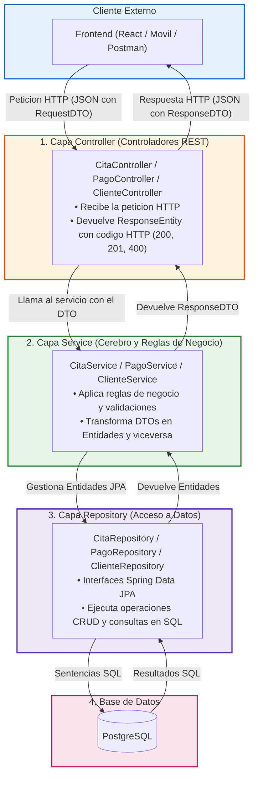

# Capítulo 1: Introducción, Fundamentos y Arquitectura en Capas

¡Bienvenido al tutorial completo de construcción de una **API REST profesional para Agendamiento de Citas** con Java y Spring Boot!

Este tutorial fue diseñado especialmente para **estudiantes y principiantes**. No asumiremos que ya conoces los conceptos avanzados: explicaremos cada pieza paso a paso, con analogías cotidianas y diagramas claros.

---

## 1. ¿Qué es una API REST y cómo funciona?

Imagina que vas a un restaurante:
1. Tú eres el **Cliente** (puede ser una página web en React, una app móvil en Android o una aplicación de escritorio).
2. El cocinero es la **Base de Datos** (donde están guardados los ingredientes y datos reales).
3. El mesero es la **API REST**: tú no entras a la cocina a revolver las ollas directamente; en su lugar, le pides al mesero lo que deseas, él va a la cocina, solicita la preparación y te trae el platillo a la mesa en un formato estándar (un plato servido).

En términos informáticos:
- El cliente envía una **Petición HTTP** (*Request*) a una dirección URL (ej: `POST /api/citas`).
- La API procesa la solicitud, valida las reglas, consulta la base de datos y devuelve una **Respuesta HTTP** (*Response*) con un código de estado (ej: `201 CREATED`) y datos en formato **JSON**.

### ¿Qué es JSON?
Es un formato de texto simple y ligero para intercambiar información entre computadoras. Ejemplo:
```json
{
  "nombre": "Juan Pérez",
  "email": "juan.perez@example.com",
  "telefono": "555-1234"
}
```

---

## 2. El Problema que Resuelve este Proyecto

Construiremos un sistema real de **Agendamiento y Gestión de Citas Médicas o Profesionales** con 5 entidades interconectadas:
1. **Clientes:** Personas que solicitan citas.
2. **Profesionales:** Especialistas que atienden las consultas.
3. **Servicios:** Catálogo de tratamientos o prestaciones con su precio y duración en minutos.
4. **Citas:** El evento principal que vincula al cliente, al profesional, al servicio, en una fecha y hora determinada, con un estado (`PENDIENTE`, `CONFIRMADA`, `CANCELADA`, `COMPLETADA`).
5. **Pagos:** Registro financiero del cobro de una cita.

---

## 3. ¿Por qué usamos una Arquitectura en Capas?

Si pusiéramos todo el código (conexión a base de datos, validaciones matemáticas, generación de JSON y control web) dentro de un solo archivo, tendríamos lo que en programación se conoce como **"Código Espagueti"**: imposible de mantener, probar o modificar sin romper algo.

Por eso dividimos nuestra aplicación en **capas independientes**, donde cada una tiene una única responsabilidad:



### Resumen de cada capa:

1. **`controller` (Controladores):** Son la puerta de entrada. Su única tarea es escuchar la petición web, pedirle al servicio que haga el trabajo y devolver la respuesta.
2. **`service` (Servicios):** Son los directores de orquesta. Aquí se comprueban las reglas de negocio (ejemplo: *"un profesional no puede tener dos citas a la misma hora"*).
3. **`repository` (Repositorios):** Encargados exclusivos de consultar o guardar información en la base de datos PostgreSQL.
4. **`model` (Modelos y Entidades):** Clases Java que representan exactamente las tablas y relaciones de la base de datos.
5. **`dto` (Data Transfer Objects):** Objetos diseñados específicamente para transferir datos hacia y desde el exterior, protegiendo las entidades internas.
6. **`exception` (Manejo de Errores):** Atrapa cualquier fallo o regla incumplida y lo transforma en un mensaje de error elegante y comprensible.
7. **`config` (Configuraciones):** Ajustes globales de la app (CORS, Swagger, datos iniciales de prueba).

---

## 4. Estructura de Paquetes en el Proyecto

Dentro de `src/main/java/com/example/citas/`, el proyecto está organizado de la siguiente forma:

```
com.example.citas/
│
├── citasApplication.java    <- Clase principal que arranca Spring Boot
│
├── config/                      <- Configuraciones auxiliares
│   ├── CorsConfig.java          <- Permite conectar frontends externos
│   ├── DataSeederConfig.java    <- Siembra datos de prueba al iniciar
│   └── OpenApiConfig.java       <- Configuración de Swagger / Scalar
│
├── controller/                  <- Puertas de entrada HTTP
│   ├── CitaController.java
│   ├── ClienteController.java
│   ├── PagoController.java
│   ├── ProfesionalController.java
│   └── ServicioController.java
│
├── dto/                         <- Objetos de Transferencia de Datos (Records)
│   ├── CitaRequestDTO.java / CitaResponseDTO.java
│   ├── ClienteRequestDTO.java / ClienteResponseDTO.java
│   ├── PagoRequestDTO.java / PagoResponseDTO.java
│   ├── ProfesionalRequestDTO.java / ProfesionalResponseDTO.java
│   └── ServicioRequestDTO.java / ServicioResponseDTO.java
│
├── exception/                   <- Manejo controlado de fallos
│   ├── GlobalExceptionHandler.java
│   ├── RecursoNoEncontradoException.java
│   └── ReglaDeNegocioException.java
│
├── model/                       <- Persistencia de datos
│   ├── base/
│   │   └── BaseEntity.java      <- Clase abstracta con ID y marcas de tiempo
│   ├── embeddable/
│   │   └── Contacto.java        <- Objeto embebido (@Embeddable)
│   ├── entity/                  <- Entidades que se convierten en tablas
│   │   ├── Cita.java
│   │   ├── Cliente.java
│   │   ├── Pago.java
│   │   ├── Profesional.java
│   │   └── Servicio.java
│   └── enums/                   <- Tipos enumerados
│       ├── EstadoCita.java
│       └── MetodoPago.java
│
├── repository/                  <- Acceso a PostgreSQL (Spring Data JPA)
│   ├── CitaRepository.java
│   ├── ClienteRepository.java
│   ├── PagoRepository.java
│   ├── ProfesionalRepository.java
│   └── ServicioRepository.java
│
└── service/                     <- Lógica de negocio
    ├── CitaService.java
    ├── ClienteService.java
    ├── PagoService.java
    ├── ProfesionalService.java
    └── ServicioService.java
```

En el siguiente capítulo revisaremos **las dependencias y la configuración del proyecto** paso a paso.
