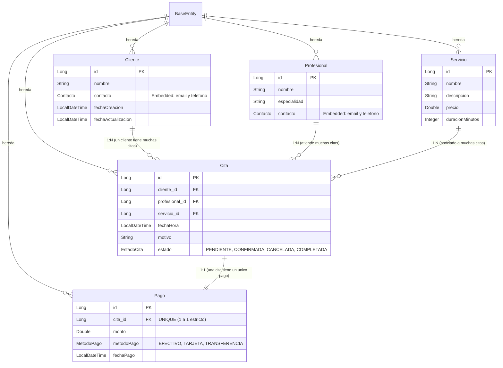

# Capítulo 3: Modelo de Datos, Entidades y Relaciones JPA

En este capítulo aprenderás cómo Java se comunica con las tablas de la base de datos utilizando **JPA (Java Persistence API)** y **Hibernate**, sin tener que escribir sentencias SQL manuales `CREATE TABLE` ni `INSERT INTO`.

---

## 1. ¿Qué es un ORM y qué es una Entidad JPA?

En Java pensamos en **Objetos** (instancias de clases con atributos y métodos). En las bases de datos relacionales se piensa en **Tablas** (filas y columnas).

Un **ORM (Mapeador Objeto-Relacional)** como Hibernate se encarga de traducir automáticamente una clase Java a una tabla de base de datos.
- Una **Entidad** es una clase Java anotada con `@Entity` que le indica a Spring: *"Crea una tabla en la base de datos con los atributos de esta clase"*.

---

## 2. La Superclase `@MappedSuperclass` ([BaseEntity.java](../src/main/java/com/example/citas/model/base/BaseEntity.java))

En casi todas las aplicaciones reales, todas las tablas necesitan:
1. Una clave primaria única (`id`).
2. La fecha y hora exacta en que se creó el registro (`fechaCreacion`).
3. La fecha y hora de la última modificación (`fechaActualizacion`).

En lugar de repetir estos tres campos en cada entidad, creamos una **Superclase Mapeada**:

```java
package com.example.citas.model.base;

import java.time.LocalDateTime;
import org.springframework.data.annotation.CreatedDate;
import org.springframework.data.annotation.LastModifiedDate;
import org.springframework.data.jpa.domain.support.AuditingEntityListener;
import jakarta.persistence.*;

@MappedSuperclass
@EntityListeners(AuditingEntityListener.class)
public abstract class BaseEntity {

    @Id
    @GeneratedValue(strategy = GenerationType.IDENTITY)
    private Long id;

    @CreatedDate
    @Column(name = "fecha_creacion", updatable = false)
    private LocalDateTime fechaCreacion;

    @LastModifiedDate
    @Column(name = "fecha_actualizacion")
    private LocalDateTime fechaActualizacion;

    // Constructores, Getters y Setters
}
```

### ¿Qué hace cada anotación de Spring Data JPA aquí?
- **`@MappedSuperclass`:** Indica a JPA que esta clase no se convertirá en una tabla por sí misma, sino que sus campos serán **heredados** por todas las entidades hijas.
- **`@EntityListeners(AuditingEntityListener.class)`:** Activa un observador de Spring que detecta cuándo se inserta o modifica un registro.
- **`@CreatedDate`:** Spring asigna la fecha y hora actual automáticamente al hacer el primer guardado (`updatable = false` asegura que nunca sea modificada después).
- **`@LastModifiedDate`:** Spring actualiza la marca de tiempo cada vez que se modifique cualquier atributo del registro.
- **`@EnableJpaAuditing`:** Se coloca en [CitasApplication.java](../src/main/java/com/example/citas/CitasApplication.java) para encender este motor de auditoría automática.

---

## 3. Objetos Embebidos con `@Embeddable` y `@Embedded`

Tanto los **Clientes** como los **Profesionales** tienen información de contacto: un `email` y un `telefono`.
Para evitar duplicar atributos y modelar conceptos limpios de Programación Orientada a Objetos, creamos un **Objeto de Valor Embebido**:

### La clase embebible ([Contacto.java](../src/main/java/com/example/citas/model/embeddable/Contacto.java)):
```java
package com.example.citas.model.embeddable;

import jakarta.persistence.Column;
import jakarta.persistence.Embeddable;

@Embeddable
public class Contacto {

    @Column(name = "email")
    private String email;

    @Column(name = "telefono")
    private String telefono;

    // Constructores, getters y setters
}
```

### El uso en la entidad ([Cliente.java](../src/main/java/com/example/citas/model/entity/Cliente.java)):
```java
@Entity
@Table(name = "clientes")
public class Cliente extends BaseEntity {

    private String nombre;

    @Embedded
    private Contacto contacto;

    // ...
}
```
*En la base de datos no se crea una tabla separada de contactos: los campos `email` y `telefono` se guardan directamente dentro de la tabla `clientes` y `profesionales`.*

---

## 4. Enumeraciones Tipadas ([EstadoCita.java](../src/main/java/com/example/citas/model/enums/EstadoCita.java) y [MetodoPago.java](../src/main/java/com/example/citas/model/enums/MetodoPago.java))

En vez de permitir que un programador guarde cualquier texto libre como `"pendiente"`, `"Pendiente"` o `"pndiente"`, usamos **Java Enums** para restringir los valores permitidos:

```java
public enum EstadoCita {
    PENDIENTE, CONFIRMADA, CANCELADA, COMPLETADA
}

public enum MetodoPago {
    EFECTIVO, TARJETA, TRANSFERENCIA
}
```

En la entidad `Cita`:
```java
@Enumerated(EnumType.STRING)
@Column(nullable = false)
private EstadoCita estado = EstadoCita.PENDIENTE;
```
> **Nota de oro:** Siempre usa `EnumType.STRING`. Si usas `EnumType.ORDINAL` (el valor por defecto), JPA guardará números (`0, 1, 2...`) y si en el futuro cambias el orden de los enums en tu código, todos los datos de tu base de datos quedarán corruptos.

---

## 5. Las 5 Entidades y sus Relaciones

Veamos el diagrama de relaciones entre nuestras tablas:



### A. Relación Uno a Muchos (1:N): `Cliente` ➔ `Cita`
Un cliente puede tener **muchas** citas registradas en el sistema.

- **Lado "Muchos" ([Cita.java](../src/main/java/com/example/citas/model/entity/Cita.java)):**
  Lleva la clave foránea `cliente_id`:
  ```java
  @ManyToOne(optional = false)
  @JoinColumn(name = "cliente_id", nullable = false)
  private Cliente cliente;
  ```
- **Lado "Uno" ([Cliente.java](../src/main/java/com/example/citas/model/entity/Cliente.java)):**
  Tiene la lista de citas relacionadas:
  ```java
  @OneToMany(mappedBy = "cliente", cascade = CascadeType.ALL, orphanRemoval = true)
  private List<Cita> citas = new ArrayList<>();
  ```

### B. Relación Uno a Uno (1:1): `Cita` ➔ `Pago`
Cada cita agendada tiene **un único comprobante de pago** asociado, y cada pago pertenece exclusivamente a esa cita.

- **En la entidad dueña de la relación ([Pago.java](../src/main/java/com/example/citas/model/entity/Pago.java)):**
  ```java
  @OneToOne(optional = false)
  @JoinColumn(name = "cita_id", referencedColumnName = "id", unique = true, nullable = false)
  private Cita cita;
  ```
  > `unique = true` le indica a la base de datos que la columna `cita_id` no puede repetirse en la tabla de pagos, garantizando una relación 1 a 1 estricta a nivel de base de datos.

- **En la entidad inversa ([Cita.java](../src/main/java/com/example/citas/model/entity/Cita.java)):**
  ```java
  @OneToOne(mappedBy = "cita", cascade = CascadeType.ALL)
  private Pago pago;
  ```

### C. Relaciones con `Profesional` y `Servicio`:
- Una `Cita` tiene asignado un `@ManyToOne Profesional profesional;`
- Una `Cita` tiene contratado un `@ManyToOne Servicio servicio;`

En el siguiente capítulo explicaremos por qué **nunca** debes devolver estas entidades directamente al exterior y cómo el **Patrón DTO** soluciona este problema.
