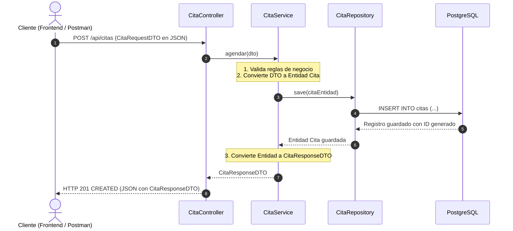

# Capítulo 4: El Patrón DTO (Data Transfer Object) y Java Records

El patrón **DTO (Objeto de Transferencia de Datos)** es uno de los conceptos de diseño más importantes en el desarrollo de APIs modernas. En este capítulo entenderás por qué es una pésima práctica exponer entidades JPA directamente y cómo los DTOs resuelven este problema con elegancia.

---

## 1. ¿Qué es un DTO?

Un **DTO** es una clase simple cuyo único objetivo es transportar datos entre el cliente (frontend) y el servidor (backend).
A diferencia de las Entidades JPA:
- **No** tiene anotaciones de base de datos (`@Entity`, `@Table`, etc.).
- **No** está conectado a la base de datos ni a Hibernate.
- Solo contiene los campos exactos que entran o salen en una operación web específica.

---

## 2. Los 3 Peligros Fatales de NO Usar DTOs

Si un principiante expone directamente su entidad `Cliente` o `Cita` en el controlador, se topará con tres problemas muy comunes:

### A. El problema del "Ciclo Infinito" (Recursión JSON)
Observa nuestra relación:
1. `Cliente` tiene una lista de `citas`.
2. Cada `Cita` tiene adentro a su `cliente`.

Cuando Spring intenta convertir la Entidad a JSON:
- Lee el cliente...
- El cliente tiene citas, así que lee la primera cita...
- La cita tiene adentro al cliente, así que vuelve a leer el cliente...
- El cliente vuelve a tener citas...

**Resultado:** El servidor colapsa arrojando un error de memoria `StackOverflowError` (*Bucle infinito de serialización*).
**Solución con DTO:** [CitaResponseDTO.java](../src/main/java/com/example/citas/dto/CitaResponseDTO.java) solo incluye los datos que queremos mostrar del cliente ([ClienteResponseDTO.java](../src/main/java/com/example/citas/dto/ClienteResponseDTO.java)), cortando cualquier ciclo de raíz.

### B. Ataque de Sobre-envío (*Over-Posting / Mass Assignment*)
Si aceptas directamente la entidad `Cita` en un `POST /api/citas`:
Un usuario malintencionado podría enviar en el JSON:
```json
{
  "id": 999,
  "estado": "COMPLETADA",
  "fechaCreacion": "2000-01-01"
}
```
Y si tu entidad acepta esos valores directamente, el atacante habrá alterado el ID o el estado sin autorización.
**Solución con DTO:** En [CitaRequestDTO.java](../src/main/java/com/example/citas/dto/CitaRequestDTO.java) **NO existe el campo `id`**. Es imposible que el cliente lo manipule porque la base de datos lo genera de forma autónoma.

### C. Fuga de Datos Confidenciales
Imagina que en el futuro tu entidad `Cliente` almacena una contraseña o un costo interno confidencial. Si devuelves la entidad completa, esos datos viajarán por la red a la vista de cualquiera. Con un DTO de respuesta, solo viaja lo que tú decidas.

---

## 3. ¿Por qué usamos Java Records para los DTOs?

A partir de Java 16, Java introdujo los **Records**. Un Record es una clase especial optimizada para datos inmutables.

### Comparativa:
#### Una clase tradicional requeriría más de 30 líneas:
```java
public final class ClienteRequestDTO {
    private final String nombre;
    private final String email;
    // Constructor con parámetros...
    // Getters para cada campo...
    // equals() y hashCode()...
    // toString()...
}
```

#### Con Java Record se define en una sola línea limpia:
```java
public record ClienteRequestDTO(String nombre, String email, String telefono) {}
```
Java genera automáticamente en segundo plano:
- Todos los campos como privados e inmutables (`final`).
- El constructor canónico.
- Los métodos accesores (`dto.nombre()`, `dto.email()`).
- Los métodos `equals()`, `hashCode()` y `toString()`.

---

## 4. DTO de Entrada (*Request*) vs DTO de Salida (*Response*)

Para cada entidad del sistema tenemos dos tipos de DTOs:

### A. Para Citas:
- **[CitaRequestDTO.java](../src/main/java/com/example/citas/dto/CitaRequestDTO.java) (Lo que el cliente envía al agendar):**
  Solo pide los IDs de las entidades relacionadas y los datos de la cita:
  ```java
  public record CitaRequestDTO(
      Long clienteId,
      Long profesionalId,
      Long servicioId,
      LocalDateTime fechaHora,
      String motivo,
      String estado
  ) {}
  ```
- **[CitaResponseDTO.java](../src/main/java/com/example/citas/dto/CitaResponseDTO.java) (Lo que el cliente recibe tras agendar):**
  Devuelve la información completa y formateada, incluyendo los DTOs completos de las relaciones y el pago si existe:
  ```java
  public record CitaResponseDTO(
      Long id,
      ClienteResponseDTO cliente,
      ProfesionalResponseDTO profesional,
      ServicioResponseDTO servicio,
      LocalDateTime fechaHora,
      String motivo,
      String estado,
      PagoResponseDTO pago
  ) {}
  ```

### B. Para Pagos:
- **[PagoRequestDTO.java](../src/main/java/com/example/citas/dto/PagoRequestDTO.java):**
  ```java
  public record PagoRequestDTO(Long citaId, Double monto, String metodoPago, LocalDateTime fechaPago) {}
  ```
- **[PagoResponseDTO.java](../src/main/java/com/example/citas/dto/PagoResponseDTO.java):**
  ```java
  public record PagoResponseDTO(Long id, Long citaId, Double monto, String metodoPago, LocalDateTime fechaPago) {}
  ```

---

## 5. El Flujo de Transformación

En la capa de servicio se realiza la magia de conversión:



En el siguiente capítulo veremos cómo la capa **Repository** interactúa con la base de datos sin escribir SQL manual.
