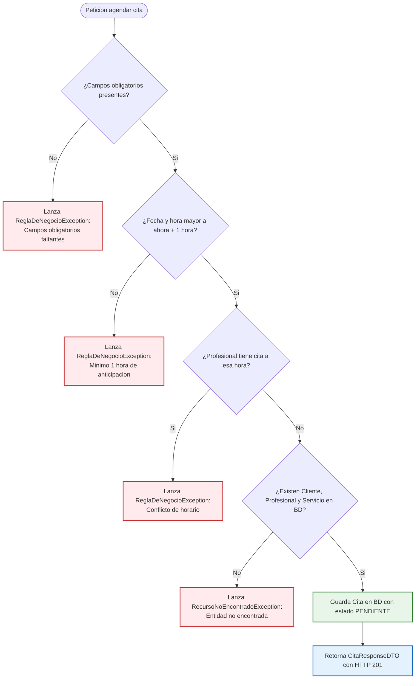

# Capítulo 6: Capa de Servicio y Reglas de Negocio

En este capítulo estudiarás el componente más importante de una aplicación: la **Capa de Servicio (`@Service`)**. Aquí vive la lógica de negocio, las validaciones y las reglas del mundo real que garantizan que el sistema funcione correctamente y no admita datos incoherentes.

---

## 1. ¿Qué es un `@Service` y cuál es su responsabilidad?

El **Servicio** es el mediador entre los Controladores (que reciben peticiones web) y los Repositorios (que guardan datos).
Sus responsabilidades son:
1. **Validar las entradas:** Verificar que los campos no estén vacíos y cumplan con las reglas de negocio.
2. **Consultar o verificar existencia:** Asegurarse de que las entidades relacionadas (cliente, profesional, servicio) existan en la base de datos antes de crear una cita.
3. **Mapear datos:** Transformar los `RequestDTO` que envía el usuario en `Entidades JPA`, y luego transformar las `Entidades` guardadas en `ResponseDTO` para devolverlas.

---

## 2. Inyección de Dependencias por Constructor (Buena Práctica Oficial)

En versiones antiguas de Spring Boot era común ver la anotación `@Autowired` directamente sobre los atributos:
```java
// ❌ MALA PRÁCTICA (Inyección de campo):
@Autowired
private CitaRepository citaRepository;
```

En nuestro proyecto usamos la **Inyección por Constructor**, que es la recomendación oficial de Spring y la industria:
```java
// ✅ BUENA PRÁCTICA:
@Service
public class CitaService {

    private final CitaRepository citaRepository;
    private final ClienteRepository clienteRepository;

    // Constructor explícito (sin Lombok ni @Autowired necesario):
    public CitaService(CitaRepository citaRepository, ClienteRepository clienteRepository) {
        this.citaRepository = citaRepository;
        this.clienteRepository = clienteRepository;
    }
    // ...
}
```

### ¿Por qué es mejor la inyección por constructor?
1. **Inmutabilidad:** Los atributos se declaran como `final`, garantizando que nadie pueda reasignarlos una vez creado el servicio.
2. **Facilidad para pruebas unitarias:** Puedes instanciar el servicio en un test con `new CitaService(repoMock1, repoMock2)` sin necesidad de levantar todo el contexto pesado de Spring.
3. **Imposible olvidar dependencias:** Si intentas crear el servicio sin pasarle sus repositorios, el compilador te avisa de inmediato.

---

## 3. Las Reglas de Negocio Implementadas Paso a Paso

El siguiente diagrama ilustra cómo el servicio evalúa cada regla antes de permitir que una cita sea guardada en la base de datos:



---

### Regla 1: Anticipación de Citas en el Futuro
* **Problema real:** Un usuario no puede agendar una cita médica en el pasado, ni tampoco agendarla para dentro de 5 minutos, porque el profesional no tendría tiempo de prepararse.
* **Código en [CitaService.java](../src/main/java/com/example/citas/service/CitaService.java#L58-L61):**
  ```java
  if (dto.fechaHora().isBefore(LocalDateTime.now().plusHours(1))) {
      throw new ReglaDeNegocioException("La cita debe agendarse con al menos 1 hora de anticipación en una fecha y hora futura");
  }
  ```
* **Explicación:** Compara la fecha enviada en el DTO contra la hora del sistema más 1 hora (`LocalDateTime.now().plusHours(1)`). Si es menor, detiene el proceso inmediatamente lanzando `ReglaDeNegocioException`.

---

### Regla 2: Prevención de Choque de Horarios (Agenda Libre del Profesional)
* **Problema real:** Un médico o especialista no puede atender a dos pacientes en el mismo consultorio a la misma hora exacta.
* **Código en [CitaService.java](../src/main/java/com/example/citas/service/CitaService.java#L63-L66):**
  ```java
  if (citaRepository.existsByProfesionalIdAndFechaHora(dto.profesionalId(), dto.fechaHora())) {
      throw new ReglaDeNegocioException("El profesional seleccionado ya cuenta con una cita agendada para la fecha y hora indicada");
  }
  ```
* **Explicación:** Consulta a la base de datos si ya existe alguna cita registrada con ese `profesionalId` y en esa `fechaHora`. Si existe, se rechaza la solicitud.

---

### Regla 3: Protección contra Eliminación de Citas con Pago Registrado
* **Problema real:** Si un cliente ya pagó una cita, no podemos simplemente borrar el registro de la base de datos sin un proceso previo de anulación contable o reembolso.
* **Código en [CitaService.java](../src/main/java/com/example/citas/service/CitaService.java#L120-L125):**
  ```java
  Cita cita = citaRepository.findById(id)
          .orElseThrow(() -> new RecursoNoEncontradoException("Cita no encontrada con id: " + id));

  if (cita.getPago() != null) {
      throw new ReglaDeNegocioException("No se puede eliminar la cita porque ya tiene un pago registrado. Debe tramitarse una anulación de pago previa");
  }

  citaRepository.delete(cita);
  ```

---

### Regla 4: Cobro Válido del Servicio y Citas Canceladas
* **Problema real:**
  1. No se puede cobrar una cita que ya fue cancelada.
  2. El cliente no puede pagar una cantidad menor al precio fijado para el servicio contratado.
* **Código en [PagoService.java](../src/main/java/com/example/citas/service/PagoService.java#L53-L67):**
  ```java
  // 1. Prohibido pagar citas canceladas
  if (cita.getEstado() == EstadoCita.CANCELADA) {
      throw new ReglaDeNegocioException("No se puede registrar un pago para una cita que ha sido cancelada");
  }

  // 2. Monto suficiente para cubrir el precio del servicio
  Double precioServicio = cita.getServicio().getPrecio();
  if (dto.monto() < precioServicio) {
      throw new ReglaDeNegocioException("El monto a pagar ($" + dto.monto() + ") no puede ser menor al precio del servicio ($" + precioServicio + ")");
  }
  ```

---

### Regla 5: Restricción Estricta de Pago Único (Relación 1 a 1)
* **Problema real:** Una cita no puede tener dos pagos duplicados.
* **Código en [PagoService.java](../src/main/java/com/example/citas/service/PagoService.java#L58-L61):**
  ```java
  if (pagoRepository.existsByCitaId(dto.citaId())) {
      throw new ReglaDeNegocioException("La cita con id " + dto.citaId() + " ya cuenta con un pago registrado (relación 1 a 1)");
  }
  ```
* **Acción secundaria inteligente:** Cuando el pago se registra exitosamente, si la cita estaba en estado `PENDIENTE`, el servicio la actualiza automáticamente a `CONFIRMADA`:
  ```java
  if (cita.getEstado() == EstadoCita.PENDIENTE) {
      cita.setEstado(EstadoCita.CONFIRMADA);
      citaRepository.save(cita);
  }
  ```

---

### Regla 6: Unicidad de Correo Electrónico
* **Problema real:** Dos clientes no pueden registrarse con el mismo correo electrónico.
* **Código en [ClienteService.java](../src/main/java/com/example/citas/service/ClienteService.java#L39-L41):**
  ```java
  if (clienteRepository.existsByContactoEmail(dto.email().trim())) {
      throw new ReglaDeNegocioException("Ya existe un cliente registrado con el email: " + dto.email());
  }
  ```

---

## 4. Transformación de Listas con Java Streams

Para retornar todas las citas convertidas a DTOs de salida, utilizamos el API de **Streams de Java**:

```java
public List<CitaResponseDTO> obtenerTodas() {
    return citaRepository.findAll()
            .stream()
            .map(this::convertirADTO)
            .toList();
}
```

### ¿Cómo se lee esto?
1. `findAll()`: Trae la lista de entidades `Cita` de la base de datos.
2. `.stream()`: Abre un flujo continuo de elementos para procesarlos uno a uno.
3. `.map(this::convertirADTO)`: Pasa cada entidad por el método `convertirADTO`, obteniendo un `CitaResponseDTO`.
4. `.toList()`: Recolecta todos los DTOs transformados en una nueva lista inmutable lista para ser enviada al cliente.

En el siguiente capítulo explicaremos cómo los **Controladores** exponen estas operaciones mediante rutas HTTP y cómo se capturan los errores con el **Manejador Global de Excepciones**.
