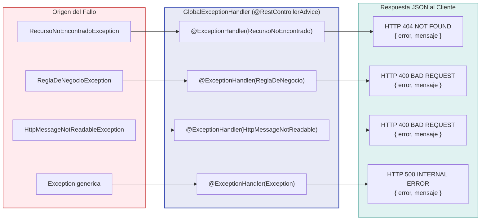

# Capítulo 7: Controladores REST y Manejo Global de Errores

En este capítulo aprenderás cómo la **Capa de Controladores (`@RestController`)** expone las operaciones de tu aplicación a través de URLs de internet, y cómo capturamos los errores para que la API responda siempre con mensajes claros y profesionales en lugar de pantallas de error caóticas.

---

## 1. ¿Qué es un `@RestController`?

Un controlador es la "fachada" pública de la API. Está marcado con dos anotaciones fundamentales:
- **`@RestController`:** Le dice a Spring que esta clase responderá peticiones web y que los valores devueltos por sus métodos se convertirán automáticamente a formato **JSON** (sin necesidad de plantillas HTML).
- **`@RequestMapping("/api/citas")`:** Define la ruta base en la URL para todas las operaciones de este controlador.

---

## 2. Los Métodos HTTP y su Significado

En una API REST profesional, el método HTTP define la **intención** de la acción que se va a realizar:

| Método HTTP | Anotación Spring | Acción | Código de Estado Recomendado |
|---|---|---|---|
| **GET** | `@GetMapping` | **Consultar** datos (no modifica nada) | `200 OK` |
| **POST** | `@PostMapping` | **Crear** un nuevo recurso | `201 CREATED` |
| **PUT** | `@PutMapping("/{id}")` | **Actualizar** un recurso existente por su ID | `200 OK` |
| **DELETE** | `@DeleteMapping("/{id}")` | **Eliminar** un recurso por su ID | `204 NO CONTENT` |

---

## 3. Ejemplo Código a Código: [CitaController.java](../src/main/java/com/example/citas/controller/CitaController.java)

Analicemos cómo está construido nuestro controlador de citas:

```java
package com.example.citas.controller;

import java.util.List;
import org.springframework.http.HttpStatus;
import org.springframework.http.ResponseEntity;
import org.springframework.web.bind.annotation.*;
import com.example.citas.dto.*;
import com.example.citas.service.CitaService;

@RestController
@RequestMapping("/api/citas")
public class CitaController {

    private final CitaService citaService;

    // Inyección de dependencias por constructor
    public CitaController(CitaService citaService) {
        this.citaService = citaService;
    }

    // 1. OBTENER TODAS LAS CITAS (GET /api/citas)
    @GetMapping
    public List<CitaResponseDTO> obtenerTodas() {
        return citaService.obtenerTodas();
    }

    // 2. OBTENER CITA POR ID (GET /api/citas/1)
    @GetMapping("/{id}")
    public ResponseEntity<CitaResponseDTO> obtenerPorId(@PathVariable Long id) {
        return ResponseEntity.ok(citaService.obtenerPorId(id));
    }

    // 3. CONSULTAR CITAS DE UN CLIENTE (GET /api/citas/cliente/1)
    @GetMapping("/cliente/{clienteId}")
    public List<CitaResponseDTO> obtenerPorCliente(@PathVariable Long clienteId) {
        return citaService.obtenerPorCliente(clienteId);
    }

    // 4. AGENDAR NUEVA CITA (POST /api/citas)
    @PostMapping
    public ResponseEntity<CitaResponseDTO> agendar(@RequestBody CitaRequestDTO dto) {
        CitaResponseDTO nuevaCita = citaService.agendar(dto);
        return ResponseEntity.status(HttpStatus.CREATED).body(nuevaCita);
    }

    // 5. ACTUALIZAR O REPROGRAMAR CITA (PUT /api/citas/1)
    @PutMapping("/{id}")
    public ResponseEntity<CitaResponseDTO> actualizar(
            @PathVariable Long id,
            @RequestBody CitaRequestDTO dto) {
        return ResponseEntity.ok(citaService.actualizar(id, dto));
    }

    // 6. ELIMINAR O CANCELAR CITA (DELETE /api/citas/1)
    @DeleteMapping("/{id}")
    public ResponseEntity<Void> eliminar(@PathVariable Long id) {
        citaService.eliminar(id);
        return ResponseEntity.noContent().build(); // Devuelve 204 sin contenido
    }
}
```

### Conceptos clave explicados:
- **`@PathVariable Long id`:** Extrae el valor que viaja directamente en la URL (ej: en `/api/citas/5`, `id` valdrá `5`).
- **`@RequestBody CitaRequestDTO dto`:** Toma el cuerpo JSON que envió el cliente en el cuerpo de la petición y lo deserializa automáticamente a nuestro Java Record.
- **`ResponseEntity<T>`:** Es un envoltorio que permite controlar con precisión tanto el **cuerpo de la respuesta** como el **código de estado HTTP** (ej: `HttpStatus.CREATED` para indicar 201).

---

## 4. Manejo Global de Errores con `@RestControllerAdvice`

Cuando ocurre un error (por ejemplo, se busca un ID que no existe o se incumple una regla de negocio), Java lanza una **Excepción**.
Si no controlas esa excepción, Spring Boot devolverá una página de error genérica `Whitelabel Error Page` con status 500 y un volcado de memoria técnico feo e inútil para el frontend.

El siguiente diagrama muestra cómo `@RestControllerAdvice` intercepta cada fallo en el camino y lo traduce en una respuesta HTTP limpia:



Para solucionar esto, creamos un **Interprete Central de Errores** con `@RestControllerAdvice` ([GlobalExceptionHandler.java](../src/main/java/com/example/citas/exception/GlobalExceptionHandler.java)):

```java
package com.example.citas.exception;

import java.util.HashMap;
import java.util.Map;
import org.springframework.http.HttpStatus;
import org.springframework.http.ResponseEntity;
import org.springframework.http.converter.HttpMessageNotReadableException;
import org.springframework.web.bind.annotation.ExceptionHandler;
import org.springframework.web.bind.annotation.RestControllerAdvice;
import org.springframework.web.method.annotation.MethodArgumentTypeMismatchException;

@RestControllerAdvice
public class GlobalExceptionHandler {

    // 1. Cuando un recurso no existe (Devuelve 404 NOT FOUND)
    @ExceptionHandler(RecursoNoEncontradoException.class)
    public ResponseEntity<Map<String, String>> manejarNoEncontrado(RecursoNoEncontradoException ex) {
        Map<String, String> respuesta = new HashMap<>();
        respuesta.put("error", "Recurso no encontrado");
        respuesta.put("mensaje", ex.getMessage());
        return ResponseEntity.status(HttpStatus.NOT_FOUND).body(respuesta);
    }

    // 2. Cuando se viola una regla de negocio (Devuelve 400 BAD REQUEST)
    @ExceptionHandler(ReglaDeNegocioException.class)
    public ResponseEntity<Map<String, String>> manejarReglaDeNegocio(ReglaDeNegocioException ex) {
        Map<String, String> respuesta = new HashMap<>();
        respuesta.put("error", "Violación de regla de negocio");
        respuesta.put("mensaje", ex.getMessage());
        return ResponseEntity.status(HttpStatus.BAD_REQUEST).body(respuesta);
    }

    // 3. Cuando envían un JSON mal formado o fecha inválida (Devuelve 400 BAD REQUEST)
    @ExceptionHandler(HttpMessageNotReadableException.class)
    public ResponseEntity<Map<String, String>> manejarJsonInvalido(HttpMessageNotReadableException ex) {
        Map<String, String> respuesta = new HashMap<>();
        respuesta.put("error", "Solicitud mal formada");
        respuesta.put("mensaje", "El formato JSON enviado es inválido o contiene campos con tipos/fechas erróneas (formato esperado: AAAA-MM-DDTHH:mm:ss)");
        return ResponseEntity.status(HttpStatus.BAD_REQUEST).body(respuesta);
    }

    // 4. Cuando envían letras en un ID numérico de URL (Devuelve 400 BAD REQUEST)
    @ExceptionHandler(MethodArgumentTypeMismatchException.class)
    public ResponseEntity<Map<String, String>> manejarTipoInvalido(MethodArgumentTypeMismatchException ex) {
        Map<String, String> respuesta = new HashMap<>();
        respuesta.put("error", "Parámetro inválido");
        respuesta.put("mensaje", "El valor del parámetro '" + ex.getName() + "' debe ser numérico");
        return ResponseEntity.status(HttpStatus.BAD_REQUEST).body(respuesta);
    }

    // 5. Errores no previstos del sistema (Devuelve 500 INTERNAL SERVER ERROR)
    @ExceptionHandler(Exception.class)
    public ResponseEntity<Map<String, String>> manejarErroresGenerales(Exception ex) {
        Map<String, String> respuesta = new HashMap<>();
        respuesta.put("error", "Error interno");
        respuesta.put("mensaje", "Ha ocurrido un error inesperado al procesar la solicitud");
        return ResponseEntity.status(HttpStatus.INTERNAL_SERVER_ERROR).body(respuesta);
    }
}
```

### ¿Qué logramos con esto?
Cualquiera sea el error que ocurra en cualquier parte de la API, el cliente siempre recibirá un objeto JSON predecible, elegante y descriptivo:
```json
{
  "error": "Violación de regla de negocio",
  "mensaje": "El profesional seleccionado ya cuenta con una cita agendada para la fecha y hora indicada"
}
```

---

## 5. Configuración de CORS ([CorsConfig.java](../src/main/java/com/example/citas/config/CorsConfig.java))

Los navegadores web bloquean por seguridad las peticiones cuando el frontend corre en un puerto o dominio distinto al backend (ej: React en `http://localhost:3000` y Spring en `http://localhost:8080`).

Para permitir que cualquier aplicación web se conecte sin bloqueos, configuramos CORS (*Cross-Origin Resource Sharing*):
```java
@Configuration
public class CorsConfig {

    @Bean
    public WebMvcConfigurer corsConfigurer() {
        return new WebMvcConfigurer() {
            @Override
            public void addCorsMappings(CorsRegistry registry) {
                registry.addMapping("/**")
                        .allowedOrigins("*") // Permite cualquier origen
                        .allowedMethods("GET", "POST", "PUT", "DELETE", "OPTIONS")
                        .allowedHeaders("*");
            }
        };
    }
}
```

En el siguiente capítulo veremos cómo **sembrar datos iniciales automáticamente** y cómo probar la API usando **Swagger UI y Scalar**.
