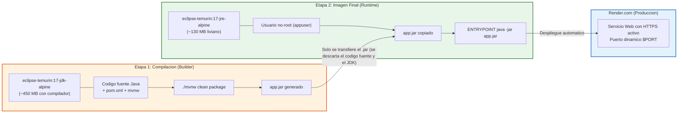

# Capítulo 9: Contenedores con Docker y Despliegue en Render.com

En este capítulo aprenderás cómo empaquetar tu aplicación para que pueda ejecutarse en cualquier servidor del mundo sin preocuparte por versiones de Java o sistemas operativos, y cómo desplegarla gratis en la nube en **Render.com**.

---

## 1. ¿Qué es Docker y por qué es fundamental?

¿Alguna vez has dicho: *"En mi computadora sí funciona, pero en la del profesor/servidor no"*?
Esto ocurre porque en cada máquina cambian las versiones de Java, variables de entorno, sistemas operativos o librerías instaladas.

**Docker** soluciona esto empaquetando tu aplicación junto con todo lo que necesita para correr (el sistema operativo base, Java 17 y tu archivo `.jar`) dentro de una caja sellada llamada **Contenedor**.
Si el contenedor corre en tu máquina, está garantizado que correrá exactamente igual en Linux, Windows, Mac o servidores en la nube.

---

## 2. Anatomía de un `Dockerfile` Multi-Etapa (*Multi-Stage*)

El siguiente diagrama muestra por qué usamos dos etapas y cómo se logra una imagen final liviana y segura para producción:



El archivo [Dockerfile](../Dockerfile) contiene las instrucciones exactas:

```dockerfile
# =========================================================================
# Etapa 1: Compilación del proyecto (Builder)
# =========================================================================
FROM eclipse-temurin:17-jdk-alpine AS builder

WORKDIR /app

# Copiamos el wrapper de Maven y el pom.xml primero
COPY .mvn/ .mvn/
COPY mvnw pom.xml ./

# Descargamos dependencias en la caché de Docker
RUN chmod +x ./mvnw && ./mvnw dependency:go-offline -B

# Copiamos el código fuente y generamos el .jar ejecutable
COPY src/ ./src/
RUN ./mvnw clean package -DskipTests -B

# =========================================================================
# Etapa 2: Imagen ligera para ejecución (Runtime)
# =========================================================================
FROM eclipse-temurin:17-jre-alpine

WORKDIR /app

# Creamos un usuario sin privilegios root por seguridad
RUN addgroup -S appgroup && adduser -S appuser -G appgroup
USER appuser

# Copiamos ÚNICAMENTE el archivo .jar generado en la Etapa 1
COPY --from=builder --chown=appuser:appgroup /app/target/*.jar app.jar

# Render define automáticamente la variable PORT
ENV PORT=8080
EXPOSE ${PORT}

# Ajuste de memoria RAM para servidores cloud económicos
ENTRYPOINT ["sh", "-c", "java -XX:+UseContainerSupport -XX:MaxRAMPercentage=75.0 -Dserver.port=${PORT} -jar app.jar"]
```

### ¿Por qué este diseño es superior?
1. **Diferencia entre JDK y JRE:**
   - La **Etapa 1** usa el JDK (*Java Development Kit*), que es pesado (~400 MB) porque incluye el compilador `javac` y herramientas de desarrollo.
   - La **Etapa 2** usa el JRE (*Java Runtime Environment*), que es ultra ligero (~120 MB) porque solo tiene lo mínimo para ejecutar el `.jar`.
   - El código fuente (`.java`), los archivos de configuración de Maven y las herramientas de compilación **se descartan**. La imagen final que sube a internet pesa menos de una cuarta parte y es mucho más segura.
2. **Seguridad (Usuario no-root):** Con `adduser appuser`, la aplicación no se ejecuta con permisos de administrador en el contenedor. Si alguien intentara vulnerar el servidor web, no podrá tomar control del sistema operativo.
3. **Control de Memoria:** `-XX:MaxRAMPercentage=75.0` evita que la máquina virtual de Java consuma toda la memoria RAM del contenedor gratuito de Render, previniendo caídas por falta de memoria (*OOMKilled*).

---

## 3. El archivo `.dockerignore`

Al igual que `.gitignore`, [.dockerignore](../.dockerignore) le dice a Docker qué carpetas no debe enviar al contenedor durante la compilación:
```
target/
.git/
.env
*.md
```
Esto reduce drásticamente el tiempo de compilación y evita subir secretos locales.

---

## 4. Despliegue en Render.com Paso a Paso

[Render.com](https://render.com/) es una plataforma cloud que permite alojar aplicaciones Spring Boot y bases de datos PostgreSQL de forma gratuita.

### Paso 1: Subir tus cambios a GitHub
```bash
git add .
git commit -m "feat: proyecto completo de citas listo para despliegue"
git push origin main
```

### Paso 2: Crear la Base de Datos PostgreSQL en Render
1. Inicia sesión en [dashboard.render.com](https://dashboard.render.com/).
2. Haz clic en **New +** ➔ **PostgreSQL**.
3. Asigna un nombre (ej: `citas-db`), selecciona la región más cercana y el plan **Free**.
4. Haz clic en **Create Database**.
5. Cuando esté lista, copia el valor de **Internal Database URL** o **External Database URL**.

### Paso 3: Crear el Web Service en Render
1. Haz clic en **New +** ➔ **Web Service**.
2. Conecta tu repositorio de GitHub donde está este proyecto.
3. Render detectará automáticamente el archivo `Dockerfile`.
4. En **Environment Variables**, agrega las tres credenciales de tu base de datos:
   - `DB_URL`: `jdbc:postgresql://<host>:<puerto>/<nombre_bd>?sslmode=require`
   - `DB_USERNAME`: El usuario de tu base de datos.
   - `DB_PASSWORD`: La contraseña de tu base de datos.
5. Haz clic en **Create Web Service**.

### Paso 4: ¡Tu API está en vivo!
Render ejecutará el Dockerfile, compilará el código, correrá el `DataSeederConfig` sembrando los datos iniciales y te entregará una URL pública segura con HTTPS:
`https://tu-servicio.onrender.com/swagger-ui/index.html`

¡Felicidades! Has aprendido a construir, estructurar, asegurar y desplegar una API REST profesional completa con Spring Boot y JPA.
