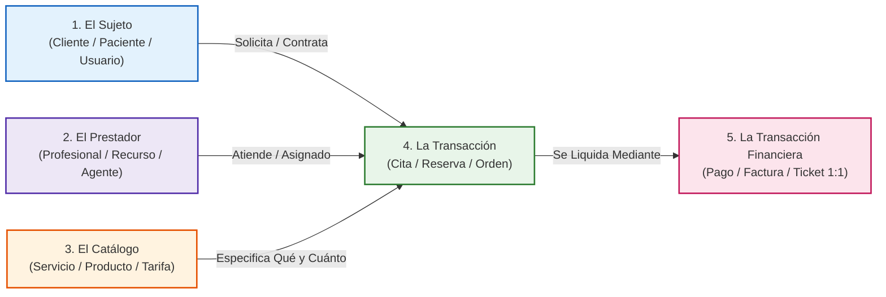
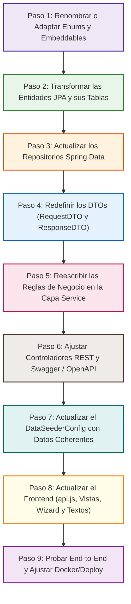
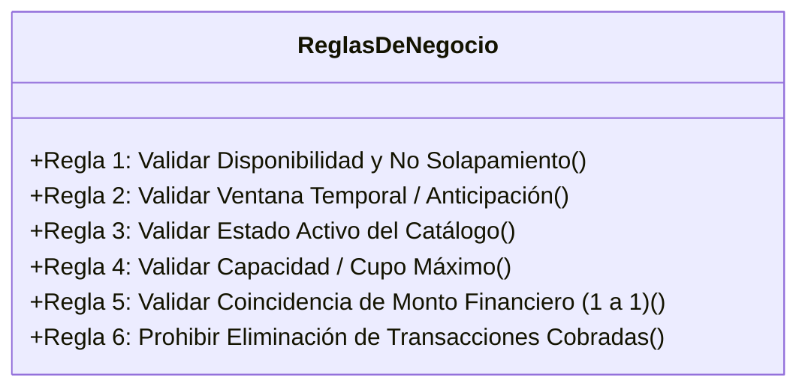
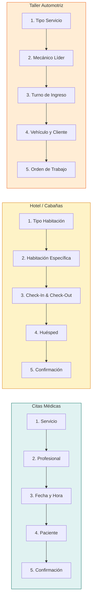

# Capítulo 10: Metodología Maestra para Transformar este Proyecto en Cualquier Otra Idea de Negocio

> **Dirigido a:** Estudiantes de ingeniería de software, desarrolladores autodidactas y profesionales que deseen utilizar la arquitectura robusta de este repositorio como plantilla base para crear cualquier sistema de gestión, reservas, alquileres, e-commerce o servicios transaccionales.

---

## 1. Introducción y Filosofía: El Patrón Universal de Software Transaccional

Uno de los mayores secretos en la industria del desarrollo de software empresarial es el siguiente: **el 90% de los sistemas de información comerciales comparten exactamente la misma estructura matemática y relacional**. 

Ya sea que estés construyendo un sistema para una clínica médica, un hotel boutique, un taller mecánico, una veterinaria, un gimnasio o una plataforma de cursos privados, la dinámica subyacente siempre involucra cinco pilares:



### ¿Por qué esta arquitectura es tan fácil de extrapolar?
Este proyecto fue diseñado bajo estándares estrictos de desacoplamiento:
1. **Sin Lombok invasivo:** Todo es Java estándar explícito, lo que te permite renombrar atributos o clases sin sorpresas de compilación ni plugins incompatibles.
2. **Java Records para DTOs:** Inmutabilidad garantizada y prevención total de loops recursivos en JSON (`Jackson`).
3. **Persistencia JPA Limpia:** Herencia mediante `@MappedSuperclass` ([BaseEntity.java](../src/main/java/com/example/citas/model/base/BaseEntity.java)) y composición con `@Embeddable` ([Contacto.java](../src/main/java/com/example/citas/model/embeddable/Contacto.java)).
4. **Validaciones en la Capa Service:** Los controladores no contienen lógica de negocio; basta con cambiar los métodos de servicio para cambiar las reglas del juego.
5. **Frontend Modular:** Un cliente React SPA con vistas independientes, componentes modulares y un archivo centralizado de consumo HTTP ([api.js](../frontend/src/api/api.js)).

---

## 2. La Matriz de Equivalencias de Negocio (El Diccionario de Traducción)

Para convertir este proyecto en tu idea propia, primero debes realizar el **Mapeo Semántico**. A continuación se presentan ejemplos reales de cómo los 5 componentes principales cambian de nombre y propósito según la industria:

| Proyecto Base (Citas Médicas) | Idea 1: Hotel / Cabañas | Idea 2: Taller Automotriz | Idea 3: Veterinaria / Spa Mascotas | Idea 4: Academia / Clases Particulares | Idea 5: Coworking / Oficinas |
| :--- | :--- | :--- | :--- | :--- | :--- |
| **`Cliente`** | `Huesped` | `PropietarioVehiculo` | `DuenoMascota` | `Estudiante` | `Miembro / Coworker` |
| **`Profesional`** | `Habitacion` / `Cabana` | `Mecanico` | `Veterinario` / `Groomer` | `Tutor` / `Profesor` | `SalaReuniones` / `Puesto` |
| **`Servicio`** | `TipoAlojamiento` | `Reparacion` / `Mantenimiento` | `Tratamiento` / `Bano` | `Curso` / `Materia` | `PlanSuscripcion` / `Tarifa` |
| **`Cita`** | `Reserva` | `OrdenTrabajo` | `TurnoClinico` | `SesionClase` | `ReservaEspacio` |
| **`Pago`** | `FacturaHospedaje` | `LiquidacionCobro` | `TicketPago` | `ComprobanteMatricula` | `ReciboPago` |
| **`Contacto` (Embeddable)** | `ContactoEmergencia` | `DatosLicenciaConductor` | `ContactoDueno` | `ContactoApoderado` | `DatosFiscales` |
| **`EstadoCita`** | `EstadoReserva` | `EstadoOrden` | `EstadoTurno` | `EstadoSesion` | `EstadoReserva` |

> [!NOTE]
> Nota que la estructura relacional **no cambia**:
> - 1 Cliente tiene N Transacciones (`@OneToMany`).
> - 1 Proveedor/Recurso tiene N Transacciones (`@OneToMany`).
> - 1 Catálogo/Servicio clasifica a N Transacciones (`@OneToMany`).
> - 1 Transacción tiene **exactamente 1 Pago** (`@OneToOne`).

---

## 3. Hoja de Ruta de Migración (Orden Cronológico Recomendado)

Para evitar errores en cascada durante la refactorización, sigue rigurosamente este orden de ejecución:



---

## 4. Paso a Paso en el Backend (Spring Boot 3 + Java 21)

### 4.1. Modificación de Clases Base y Embebidas (`model/`)

#### 1. Conservar `BaseEntity.java`
La superclase [BaseEntity.java](../src/main/java/com/example/citas/model/base/BaseEntity.java) no requiere cambios. En cualquier negocio seguirás necesitando:
- Identificador único `id` con estrategia de autoincremento.
- Fecha de creación auditada (`fechaCreacion`).
- Fecha de última actualización auditada (`fechaActualizacion`).

#### 2. Adaptar el Objeto Embebido (`@Embeddable`)
En el proyecto actual tenemos [Contacto.java](../src/main/java/com/example/citas/model/embeddable/Contacto.java) con `email` y `telefono`.
- **Si tu negocio es un Hotel:** Puedes agregar `ciudad`, `pais`, `documentoIdentidad`.
- **Si es un Taller Mecánico:** Puedes crear un embeddable `DatosVehiculo` con `placa`, `marca`, `modelo`, `kilometraje`.
- **Si es una Veterinaria:** Puedes embeber `FichaMascota` con `nombreMascota`, `especie`, `raza`, `edadAnios`.

Ejemplo para taller mecánico:
```java
package com.example.citas.model.embeddable;

import jakarta.persistence.Column;
import jakarta.persistence.Embeddable;

@Embeddable
public class DatosVehiculo {

    @Column(name = "vehiculo_placa", nullable = false, length = 15)
    private String placa;

    @Column(name = "vehiculo_marca", nullable = false, length = 50)
    private String marca;

    @Column(name = "vehiculo_kilometraje")
    private Integer kilometraje;

    public DatosVehiculo() {}

    public DatosVehiculo(String placa, String marca, Integer kilometraje) {
        this.placa = placa;
        this.marca = marca;
        this.kilometraje = kilometraje;
    }

    // Getters y Setters
}
```

#### 3. Adaptar las Enumeraciones (`enums/`)
Revisa los ciclos de vida de tus entidades:
- `EstadoCita.java`: En un hotel tendrás `EstadoReserva` (`PENDIENTE`, `CONFIRMADA`, `CHECK_IN`, `CHECK_OUT`, `CANCELADA`). En un taller tendrás `EstadoOrden` (`RECIBIDO`, `EN_DIAGNOSTICO`, `EN_REPARACION`, `FINALIZADO`, `ENTREGADO`).
- `MetodoPago.java`: Puedes mantener `EFECTIVO`, `TARJETA`, `TRANSFERENCIA` o sumar `MERCADO_PAGO`, `CRYPTO`, etc.

---

### 4.2. Transformación de las Entidades JPA (`model/entity/`)

Veamos cómo transformar la entidad central [Cita.java](../src/main/java/com/example/citas/model/entity/Cita.java) en otra entidad, por ejemplo **`Reserva` (Hotel)** o **`OrdenTrabajo` (Taller)**:

```java
package com.example.citas.model.entity;

import com.example.citas.model.base.BaseEntity;
import com.example.citas.model.enums.EstadoReserva;
import jakarta.persistence.*;
import java.time.LocalDate;

@Entity
@Table(name = "reservas")
public class Reserva extends BaseEntity {

    @ManyToOne(fetch = FetchType.EAGER)
    @JoinColumn(name = "huesped_id", nullable = false)
    private Huesped huesped;

    @ManyToOne(fetch = FetchType.EAGER)
    @JoinColumn(name = "habitacion_id", nullable = false)
    private Habitacion habitacion;

    @Column(name = "fecha_checkin", nullable = false)
    private LocalDate fechaCheckIn;

    @Column(name = "fecha_checkout", nullable = false)
    private LocalDate fechaCheckOut;

    @Column(name = "cantidad_personas", nullable = false)
    private Integer cantidadPersonas;

    @Enumerated(EnumType.STRING)
    @Column(name = "estado", nullable = false)
    private EstadoReserva estado = EstadoReserva.PENDIENTE;

    // Relación 1 a 1 con Pago: exactamente igual que en SerenityCare
    @OneToOne(mappedBy = "reserva", cascade = CascadeType.ALL, fetch = FetchType.LAZY)
    private Pago pago;

    // Constructores, Getters y Setters
}
```

> [!TIP]
> **Ventaja de mantener la relación 1 a 1 con Pago:**
> El módulo de cobros de este proyecto es uno de sus puntos más sólidos. Al mantener `Pago` como una relación `@OneToOne` con la entidad transaccional, ya tienes resuelto todo el flujo de caja, comprobantes de pago, auditoría financiera y restricciones de no eliminar registros ya cobrados.

---

### 4.3. El Patrón DTO con Java Records (`dto/`)

En SerenityCare utilizamos `Java Records` para definir los DTOs. Esto ofrece:
1. Sintaxis limpia sin getters manuales ni constructores boilerplate.
2. Inmutabilidad de datos en tránsito.
3. Desacoplamiento total: la estructura interna de la base de datos nunca se expone en la API pública.

#### Request DTO (Entrada con Validaciones Jakarta Bean Validation)
```java
package com.example.citas.dto;

import jakarta.validation.constraints.Future;
import jakarta.validation.constraints.NotNull;
import jakarta.validation.constraints.Positive;
import java.time.LocalDate;

public record ReservaRequestDTO(
    @NotNull(message = "El ID del huésped es obligatorio")
    Long huespedId,

    @NotNull(message = "El ID de la habitación es obligatorio")
    Long habitacionId,

    @NotNull(message = "La fecha de Check-In es obligatoria")
    @Future(message = "La fecha de ingreso debe ser en el futuro")
    LocalDate fechaCheckIn,

    @NotNull(message = "La fecha de Check-Out es obligatoria")
    LocalDate fechaCheckOut,

    @NotNull(message = "Debe especificar la cantidad de personas")
    @Positive(message = "La cantidad de personas debe ser al menos 1")
    Integer cantidadPersonas
) {}
```

#### Response DTO (Salida aplanada para consumo del Frontend)
```java
package com.example.citas.dto;

import com.example.citas.model.entity.Reserva;
import com.example.citas.model.enums.EstadoReserva;
import java.time.LocalDate;
import java.time.LocalDateTime;

public record ReservaResponseDTO(
    Long id,
    Long huespedId,
    String nombreHuesped,
    String emailHuesped,
    Long habitacionId,
    String numeroHabitacion,
    String tipoHabitacion,
    Double precioPorNoche,
    LocalDate fechaCheckIn,
    LocalDate fechaCheckOut,
    Integer cantidadPersonas,
    Double costoTotalEstimado,
    EstadoReserva estado,
    Boolean pagada,
    LocalDateTime fechaCreacion
) {
    public static ReservaResponseDTO fromEntity(Reserva r, Double costoTotal) {
        return new ReservaResponseDTO(
            r.getId(),
            r.getHuesped().getId(),
            r.getHuesped().getNombre(),
            r.getHuesped().getContacto().getEmail(),
            r.getHabitacion().getId(),
            r.getHabitacion().getNumero(),
            r.getHabitacion().getTipo().getNombre(),
            r.getHabitacion().getPrecioPorNoche(),
            r.getFechaCheckIn(),
            r.getFechaCheckOut(),
            r.getCantidadPersonas(),
            costoTotal,
            r.getEstado(),
            r.getPago() != null,
            r.getFechaCreacion()
        );
    }
}
```

---

### 4.4. Capa de Repositorios Spring Data JPA (`repository/`)

Los repositorios extienden `JpaRepository<T, ID>`. Solo necesitas crear los métodos de búsqueda derivados según tu caso de uso:

#### Comparativa de Métodos de Consulta según el Negocio:

| Negocio | Nombre del Método en el Repositorio | Lógica SQL Equivalente |
| :--- | :--- | :--- |
| **Citas Médicas (Actual)** | `existsByProfesionalIdAndFechaHoraAndEstadoNot(...)` | Busca si el médico ya tiene otra cita en esa hora exacta. |
| **Hotel / Hospedaje** | `existsByHabitacionIdAndFechaCheckInLessThanEqualAndFechaCheckOutGreaterThanEqualAndEstadoNot(...)` | Busca si la habitación está ocupada en el rango entre check-in y check-out. |
| **Taller Mecánico** | `existsByMecanicoIdAndFechaHoraAndEstadoNot(...)` | Busca si el mecánico ya tiene una orden programada para ese día. |
| **Academia / Cursos** | `countByCursoIdAndEstadoNot(...)` | Cuenta cuántos alumnos hay inscritos para no superar el cupo máximo del aula. |

Ejemplo en código:
```java
package com.example.citas.repository;

import com.example.citas.model.entity.Reserva;
import com.example.citas.model.enums.EstadoReserva;
import org.springframework.data.jpa.repository.JpaRepository;
import org.springframework.data.jpa.repository.Query;
import org.springframework.data.repository.query.Param;
import org.springframework.stereotype.Repository;

import java.time.LocalDate;
import java.util.List;

@Repository
public interface ReservaRepository extends JpaRepository<Reserva, Long> {

    List<Reserva> findByHuespedId(Long huespedId);

    // Consulta personalizada para detectar solapamiento de rangos de fechas
    @Query("SELECT COUNT(r) > 0 FROM Reserva r WHERE r.habitacion.id = :habitacionId " +
           "AND r.estado != :estadoCancelado " +
           "AND (:checkIn < r.fechaCheckOut AND :checkOut > r.fechaCheckIn)")
    boolean existeSolapamiento(
        @Param("habitacionId") Long habitacionId,
        @Param("checkIn") LocalDate checkIn,
        @Param("checkOut") LocalDate checkOut,
        @Param("estadoCancelado") EstadoReserva estadoCancelado
    );
}
```

---

### 4.5. Capa de Servicios y Reglas de Negocio (`service/`)

Aquí reside el valor real de tu aplicación. Toma las 6 reglas de negocio de SerenityCare y aplícalas al nuevo modelo:



#### Ejemplo de Implementación en `ReservaService.java`:
```java
package com.example.citas.service;

import com.example.citas.dto.ReservaRequestDTO;
import com.example.citas.dto.ReservaResponseDTO;
import com.example.citas.exception.RecursoNoEncontradoException;
import com.example.citas.exception.ReglaDeNegocioException;
import com.example.citas.model.entity.Habitacion;
import com.example.citas.model.entity.Huesped;
import com.example.citas.model.entity.Reserva;
import com.example.citas.model.enums.EstadoReserva;
import com.example.citas.repository.HabitacionRepository;
import com.example.citas.repository.HuespedRepository;
import com.example.citas.repository.ReservaRepository;
import org.springframework.stereotype.Service;
import org.springframework.transaction.annotation.Transactional;

import java.time.temporal.ChronoUnit;
import java.util.List;

@Service
public class ReservaService {

    private final ReservaRepository reservaRepository;
    private final HuespedRepository huespedRepository;
    private final HabitacionRepository habitacionRepository;

    public ReservaService(ReservaRepository reservaRepository, 
                          HuespedRepository huespedRepository, 
                          HabitacionRepository habitacionRepository) {
        this.reservaRepository = reservaRepository;
        this.huespedRepository = huespedRepository;
        this.habitacionRepository = habitacionRepository;
    }

    @Transactional
    public ReservaResponseDTO crearReserva(ReservaRequestDTO dto) {
        // Regla 1: Check-out debe ser posterior a Check-in
        if (!dto.fechaCheckOut().isAfter(dto.fechaCheckIn())) {
            throw new ReglaDeNegocioException("La fecha de Check-Out debe ser posterior a la fecha de Check-In.");
        }

        // Regla 2: Huésped debe existir
        Huesped huesped = huespedRepository.findById(dto.huespedId())
            .orElseThrow(() -> new RecursoNoEncontradoException("Huésped no encontrado con ID: " + dto.huespedId()));

        // Regla 3: Habitación debe existir y estar disponible
        Habitacion habitacion = habitacionRepository.findById(dto.habitacionId())
            .orElseThrow(() -> new RecursoNoEncontradoException("Habitación no encontrada con ID: " + dto.habitacionId()));

        if (!habitacion.isActiva()) {
            throw new ReglaDeNegocioException("La habitación seleccionada se encuentra actualmente en mantenimiento o inactiva.");
        }

        // Regla 4: Capacidad máxima de la habitación
        if (dto.cantidadPersonas() > habitacion.getCapacidadMaxima()) {
            throw new ReglaDeNegocioException("La capacidad máxima de la habitación es de " + 
                habitacion.getCapacidadMaxima() + " personas.");
        }

        // Regla 5: No solapamiento de fechas
        boolean ocupada = reservaRepository.existeSolapamiento(
            dto.habitacionId(), dto.fechaCheckIn(), dto.fechaCheckOut(), EstadoReserva.CANCELADA
        );
        if (ocupada) {
            throw new ReglaDeNegocioException("La habitación no tiene disponibilidad en las fechas solicitadas.");
        }

        // Cálculo de estadía y costo total
        long noches = ChronoUnit.DAYS.between(dto.fechaCheckIn(), dto.fechaCheckOut());
        double totalEstimado = noches * habitacion.getPrecioPorNoche();

        Reserva reserva = new Reserva();
        reserva.setHuesped(huesped);
        reserva.setHabitacion(habitacion);
        reserva.setFechaCheckIn(dto.fechaCheckIn());
        reserva.setFechaCheckOut(dto.fechaCheckOut());
        reserva.setCantidadPersonas(dto.cantidadPersonas());
        reserva.setEstado(EstadoReserva.PENDIENTE);

        Reserva guardada = reservaRepository.save(reserva);
        return ReservaResponseDTO.fromEntity(guardada, totalEstimado);
    }

    @Transactional
    public void eliminarReserva(Long id) {
        Reserva reserva = reservaRepository.findById(id)
            .orElseThrow(() -> new RecursoNoEncontradoException("Reserva no encontrada con ID: " + id));

        // Regla 6: Protección financiera (igual que en SerenityCare)
        if (reserva.getPago() != null) {
            throw new ReglaDeNegocioException("No se puede eliminar una reserva que ya posee un pago registrado. Debe anular el pago primero.");
        }

        reservaRepository.delete(reserva);
    }
}
```

---

### 4.6. Capa de Controladores REST y Documentación OpenAPI (`controller/`)

Solo requieres cambiar el path base y las anotaciones de Swagger:

```java
package com.example.citas.controller;

import com.example.citas.dto.ReservaRequestDTO;
import com.example.citas.dto.ReservaResponseDTO;
import com.example.citas.service.ReservaService;
import io.swagger.v3.oas.annotations.Operation;
import io.swagger.v3.oas.annotations.tags.Tag;
import jakarta.validation.Valid;
import org.springframework.http.HttpStatus;
import org.springframework.http.ResponseEntity;
import org.springframework.web.bind.annotation.*;

import java.util.List;

@RestController
@RequestMapping("/api/reservas")
@Tag(name = "Reservas", description = "Endpoints para la gestión de reservas de hospedaje")
public class ReservaController {

    private final ReservaService reservaService;

    public ReservaController(ReservaService reservaService) {
        this.reservaService = reservaService;
    }

    @PostMapping
    @Operation(summary = "Crear nueva reserva", description = "Registra una reserva validando disponibilidad y aforo.")
    public ResponseEntity<ReservaResponseDTO> crear(@Valid @RequestBody ReservaRequestDTO dto) {
        ReservaResponseDTO creada = reservaService.crearReserva(dto);
        return ResponseEntity.status(HttpStatus.CREATED).body(creada);
    }

    @DeleteMapping("/{id}")
    @Operation(summary = "Eliminar reserva", description = "Elimina la reserva si no posee pagos registrados.")
    public ResponseEntity<Void> eliminar(@PathVariable Long id) {
        reservaService.eliminarReserva(id);
        return ResponseEntity.noContent().build();
    }
}
```

---

### 4.7. Datos Iniciales de Prueba (`config/DataSeederConfig.java`)

Un error frecuente de los estudiantes es cambiar el código pero olvidar actualizar el **Seeder**, provocando fallos al iniciar la aplicación. Asegúrate de modificar `DataSeederConfig.java` para insertar instancias del nuevo modelo:

```java
// Ejemplo para Hotel:
Huesped h1 = huespedRepository.save(new Huesped("Carlos Mendoza", new Contacto("carlos@example.com", "+5491144445555")));
Habitacion hab1 = habitacionRepository.save(new Habitacion("101-A", "Suite Presidencial con vista al mar", 150.00, 4, true));
Reserva r1 = reservaRepository.save(new Reserva(h1, hab1, LocalDate.now().plusDays(2), LocalDate.now().plusDays(5), 2));
```

---

## 5. Paso a Paso en el Frontend (React + Vite SPA)

El frontend ubicado en [`frontend/`](../frontend) fue construido de manera 100% modular. Aquí te mostramos cómo transformarlo paso a paso sin romper la interactividad.

### 5.1. Actualización del Cliente HTTP ([`frontend/src/api/api.js`](../frontend/src/api/api.js))

En `api.js` solo necesitas actualizar las URLs y los nombres de las funciones exportadas:

```javascript
// Antes (Citas):
export const citasApi = {
  getAll: () => request('/citas'),
  getById: (id) => request(`/citas/${id}`),
  create: (data) => request('/citas', { method: 'POST', body: JSON.stringify(data) }),
  delete: (id) => request(`/citas/${id}`, { method: 'DELETE' }),
};

// Después (Reservas / Órdenes):
export const reservasApi = {
  getAll: () => request('/reservas'),
  getById: (id) => request(`/reservas/${id}`),
  create: (data) => request('/reservas', { method: 'POST', body: JSON.stringify(data) }),
  delete: (id) => request(`/reservas/${id}`, { method: 'DELETE' }),
};
```

---

### 5.2. Paleta de Colores y Estilo Visual ([`frontend/src/index.css`](../frontend/src/index.css))

Cada industria tiene una identidad visual diferente. Puedes cambiar el tono de tu aplicación modificando únicamente las variables CSS en la raíz:

```css
/* Paleta SerenityCare (Salud / Clínica - Tonos Esmeralda y Cian) */
:root {
  --primary: #0d9488;
  --primary-hover: #0f766e;
  --primary-light: #ccfbf1;
  --accent: #0284c7;
}

/* Opción A: Hotel Boutique / Lujo (Tonos Azul Marino, Dorado y Ámbar) */
:root {
  --primary: #1e3a8a;
  --primary-hover: #172554;
  --primary-light: #fef3c7;
  --accent: #d97706;
}

/* Opción B: Taller Mecánico / Automotriz (Tonos Naranja Industrial y Grafito) */
:root {
  --primary: #ea580c;
  --primary-hover: #c2410c;
  --primary-light: #ffedd5;
  --accent: #475569;
}

/* Opción C: Academia / Cursos (Tonos Púrpura e Índigo) */
:root {
  --primary: #6366f1;
  --primary-hover: #4f46e5;
  --primary-light: #e0e7ff;
  --accent: #8b5cf6;
}
```

---

### 5.3. Adaptación del Asistente de Reserva (Wizard en 5 Pasos)

El componente principal del agendamiento es un asistente paso a paso. Para adaptarlo a tu negocio, simplemente ajusta lo que se elige en cada etapa:



---

### 5.4. Vistas del Tablero ([`frontend/src/views/`](../frontend/src/views))

1. **`DashboardView.jsx`:** Cambia las métricas superiores (KPIs):
   - De: *"Total Pacientes"*, *"Citas Hoy"*, *"Recaudación"*
   - A: *"Huéspedes Registrados"*, *"Habitaciones Ocupadas"*, *"Noches Reservadas"*, *"Ingresos Totales"*.
2. **`CitasView.jsx` ➔ `ReservasView.jsx`:**
   - La tabla principal muestra: Código de Reserva, Huésped, Habitación, Rango de Fechas, Noches, Monto, Estado (`PENDIENTE`, `CONFIRMADA`, etc.).
   - Los botones de acción rápida se conservan: **Confirmar**, **Cancelar**, **Pagar (Abre modal de cobro 1:1)**.
3. **`PagosView.jsx`:**
   - No requiere cambios estructurales; únicamente adaptar los textos del comprobante digital (de *"Comprobante Médico"* a *"Factura de Hospedaje"* o *"Comprobante de Servicio"*).

---

## 6. Caso Práctico Completo: Transformando SerenityCare en "EcoLodge Suites"

Para que no quede ninguna duda, veamos el código comparado de los dos archivos más importantes del sistema:

### Comparativa: Entidad Transaccional

#### Antes: `Cita.java`
```java
@Entity
@Table(name = "citas")
public class Cita extends BaseEntity {
    @ManyToOne(fetch = FetchType.EAGER)
    @JoinColumn(name = "cliente_id", nullable = false)
    private Cliente cliente;

    @ManyToOne(fetch = FetchType.EAGER)
    @JoinColumn(name = "profesional_id", nullable = false)
    private Profesional profesional;

    @ManyToOne(fetch = FetchType.EAGER)
    @JoinColumn(name = "servicio_id", nullable = false)
    private Servicio servicio;

    @Column(name = "fecha_hora", nullable = false)
    private LocalDateTime fechaHora;

    @Enumerated(EnumType.STRING)
    private EstadoCita estado = EstadoCita.PENDIENTE;
}
```

#### Después: `Reserva.java`
```java
@Entity
@Table(name = "reservas")
public class Reserva extends BaseEntity {
    @ManyToOne(fetch = FetchType.EAGER)
    @JoinColumn(name = "huesped_id", nullable = false)
    private Huesped huesped;

    @ManyToOne(fetch = FetchType.EAGER)
    @JoinColumn(name = "habitacion_id", nullable = false)
    private Habitacion habitacion;

    @Column(name = "fecha_checkin", nullable = false)
    private LocalDate fechaCheckIn;

    @Column(name = "fecha_checkout", nullable = false)
    private LocalDate fechaCheckOut;

    @Enumerated(EnumType.STRING)
    private EstadoReserva estado = EstadoReserva.PENDIENTE;
}
```

---

## 7. Configuración de Infraestructura y Despliegue

Cuando cambies el nombre de tu proyecto, no olvides actualizar los siguientes archivos de configuración:

1. **`pom.xml`:**
   ```xml
   <groupId>com.ecolodge</groupId>
   <artifactId>ecolodge-api</artifactId>
   <name>EcoLodge Reservation API</name>
   <description>Sistema de gestión y reservas para hotel de cabañas</description>
   ```

2. **`.env` y `.env.example`:**
   ```env
   PORT=8080
   DATABASE_URL=jdbc:postgresql://localhost:5432/ecolodge_db
   DATABASE_USERNAME=postgres
   DATABASE_PASSWORD=postgres
   ```

3. **`render.yaml` (Despliegue Cloud en Render):**
   ```yaml
   services:
     - type: web
       name: ecolodge-api
       env: docker
       plan: free
       envVars:
         - key: DATABASE_URL
           fromDatabase:
             name: ecolodge-db
             property: connectionString
   databases:
     - name: ecolodge-db
       plan: free
   ```

---

## 8. Checklist Maestro de Transformación (20 Puntos de Control)

Utiliza esta lista de verificación para asegurarte de no haber omitido ningún detalle:

### Modelado y Persistencia (Backend)
- [ ] 1. Identificar los 5 nombres de entidades de tu nuevo dominio.
- [ ] 2. Configurar o reutilizar el `@Embeddable` ([Contacto.java](../src/main/java/com/example/citas/model/embeddable/Contacto.java) u otro).
- [ ] 3. Crear las nuevas enumeraciones de estado (`Estado...Enum`).
- [ ] 4. Crear las 5 clases `@Entity` heredando de `BaseEntity`.
- [ ] 5. Definir claves foráneas explícitas con `@JoinColumn` y nombres en minúsculas con guiones bajos (`snake_case`).
- [ ] 6. Mantener la relación `@OneToOne` entre la entidad transaccional y la entidad `Pago`.

### Transferencia de Datos y Acceso a Base de Datos
- [ ] 7. Crear los 5 `RequestDTO` con anotaciones de validación `@NotBlank`, `@NotNull`, etc.
- [ ] 8. Crear los 5 `ResponseDTO` con método mapeador `fromEntity()`.
- [ ] 9. Crear las 5 interfaces `Repository` extendiendo de `JpaRepository<T, Long>`.
- [ ] 10. Escribir las consultas personalizadas de disponibilidad o conflicto de horarios en el repositorio.

### Lógica de Negocio y Controladores
- [ ] 11. Implementar las 6 reglas de negocio dentro de la capa `Service`.
- [ ] 12. Utilizar `@Transactional` en métodos que modifiquen la base de datos.
- [ ] 13. Exponer los endpoints en los `Controller` con anotaciones `@RestController` y `@RequestMapping`.
- [ ] 14. Documentar las rutas con `@Tag` y `@Operation` para Swagger / Scalar.
- [ ] 15. Reescribir `DataSeederConfig.java` con datos de ejemplo acordes al nuevo negocio.

### Frontend y Despliegue
- [ ] 16. Actualizar las funciones de llamada HTTP en `frontend/src/api/api.js`.
- [ ] 17. Cambiar títulos, nombres de marca y descripciones en `index.html` y `Navbar.jsx`.
- [ ] 18. Actualizar las columnas de las tablas y modales en `views/` y `components/forms/`.
- [ ] 19. Comprobar la conexión local (`npm run dev` + `mvnw spring-boot:run`).
- [ ] 20. Actualizar `render.yaml` y `.env.example` con los nuevos nombres de servicio.

---

## 9. Cómo Defender este Proyecto en una Evaluación Universitaria o Entrevista

Si presentas este proyecto como trabajo de grado, examen final o proyecto de portafolio, utiliza los siguientes argumentos técnicos para destacar:

1. **"¿Por qué no usaron Lombok?"**
   > *"Decidimos no utilizar Lombok para mantener el código 100% estándar en Java 21, evitando advertencias de reflexión en el compilador, problemas con procesadores de anotaciones en entornos CI/CD y asegurando transparencia absoluta en constructores y encapsulamiento."*

2. **"¿Por qué usan Java Records en lugar de Clases DTO tradicionales?"**
   > *"Los Records introducidos en Java moderno son ideales para DTOs: son inherentemente inmutables, implementan automáticamente `equals()`, `hashCode()` y `toString()`, y evitan la sobre-exposición accidental del estado de las entidades JPA."*

3. **"¿Cómo resolvieron la integridad del pago?"**
   > *"Implementamos una relación 1 a 1 estricta en base de datos (`UNIQUE constraint`) respaldada por dos reglas de negocio en la capa Service: no permitir más de un pago por transacción y garantizar que el monto abonado cubra el arancel del servicio."*

4. **"¿Cómo evitaron solapamientos de turnos/reservas?"**
   > *"Implementamos validaciones a nivel de servicio consultando el repositorio JPA mediante Spring Data y consultas JPQL parametrizadas que verifican la no coincidencia temporal antes de persistir cualquier registro."*

---

> [!TIP]
> **Conclusión:** Dominando este patrón de 5 componentes (Sujeto, Recurso, Catálogo, Transacción y Cobro), tienes en tus manos la plantilla arquitectónica para construir el 90% de las aplicaciones comerciales del mercado laboral. ¡Éxitos en tu nuevo proyecto!
